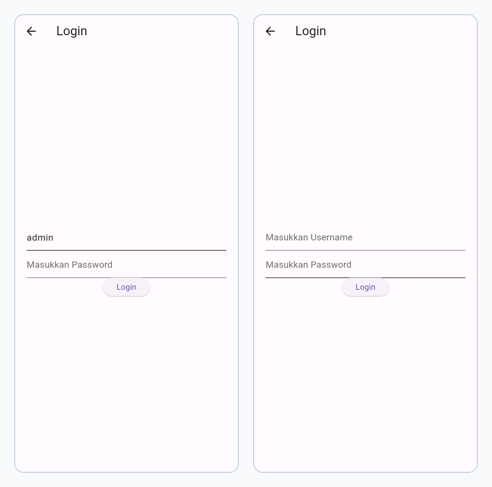
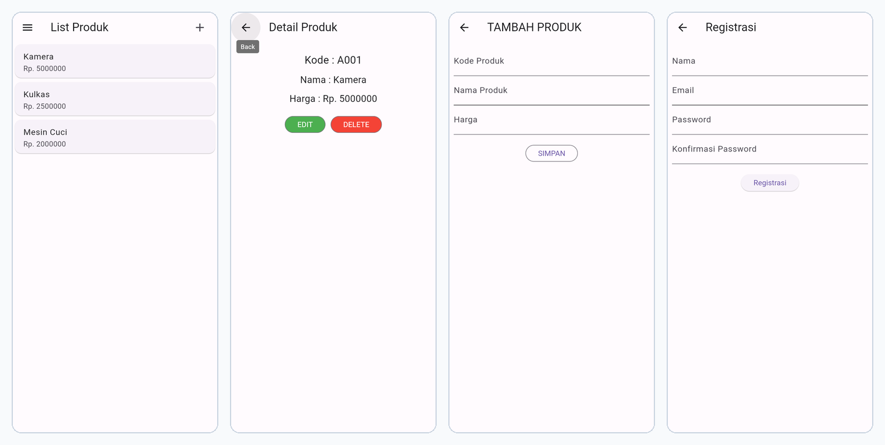

# Laporan Praktikum Pemrograman Mobile
**Nama** : M Fathan Ramdani  
**NIM** : H1D024026  
**Shift** : Awal G / Akhir C  
**Praktikum** : Pemrograman Mobile  

---

## 📝 Tugas Pertemuan 1
**Tanggal**: Selasa, 20 Oktober 2026  
**Topik**: Pengenalan Dasar Bahasa Pemrograman Dart & Pembuatan Aplikasi Pertama Flutter (Hello World)


### Laporan & Kesimpulan Praktikum:
Pada praktikum pertemuan pertama ini, saya mempelajari konsep dasar bahasa pemrograman Dart serta pengenalan awal terhadap framework Flutter. Dart menjadi fondasi utama dalam pengembangan aplikasi di Flutter karena menawarkan performa tinggi, fitur keamanan tipe data (*type safety*), dukungan *null safety*, serta sintaksis bergaya C/Java yang mudah dipahami oleh mahasiswa.

Beberapa materi yang berhasil saya pelajari, eksplorasi, dan implementasikan pada pertemuan ini antara lain:

1. **Pemahaman Dasar Bahasa Pemrograman Dart (Modul 1):**
   - **Tipe Data Fundamental**: Mempelajari dan menguji penggunaan tipe data bilangan bulat (`int`), bilangan pecahan (`double`), teks atau karakter (`String`), serta nilai kebenaran boolean (`bool`). Selain itu, saya juga mencoba penggunaan kata kunci `var` untuk penentuan tipe data secara otomatis (*type inference*).
   - **Operasi Aritmatika & Logika**: Mengimplementasikan perhitungan penjumlahan (`+`), pengurangan (`-`), perkalian (`*`), pembagian (`/`), dan sisa bagi (`%`), serta operasi perbandingan dan logika (`>`, `<`, `==`, `&&`).
   - **Struktur Kontrol**: Menerapkan percabangan bersyarat menggunakan `if-else` untuk penentuan alur program, serta perulangan berulang menggunakan `for loop` dan `while loop`.
   - **Fungsi (Functions)**: Membuat fungsi modular yang menerima parameter dan mengembalikan nilai (*return value*), seperti fungsi perhitungan aritmatika dan fungsi pencetak pesan.
   - **Pemrograman Berorientasi Objek (OOP)**: Merancang sebuah kelas (`Mahasiswa`) lengkap dengan atribut nama, NIM, usia, shift, *constructor*, serta *method* interaktif.
   - **Pustaka Bawaan (Import)**: Mengimpor dan memanfaatkan library `dart:math` untuk membangkitkan bilangan acak dan menghitung nilai pangkat serta akar kuadrat.
   - **Penanganan Kesalahan (Exception Handling)**: Mengamankan alur program dari *runtime error* dengan blok `try ... on ... catch ... finally`.
   - **Pemrograman Asinkronus (Async-Await)**: Memahami konsep eksekusi *non-blocking* menggunakan `Future`, `async`, dan `await`.

2. **Pengenalan Framework Flutter & Pembuatan Aplikasi Hello World:**
   - Memahami struktur direktori proyek Flutter, fungsi `main()` sebagai titik masuk, dan pemanggilan `runApp()`.
   - Menerapkan konsep *declarative UI* dengan hierarki *widget tree*: `MaterialApp` → `Scaffold` → `AppBar` → `Center` → `Text('Hello World')`.
   - Mengenal dan memanfaatkan fitur *Hot Reload* dan *Hot Restart* untuk mempercepat proses *development*.

---

## 📝 Tugas Pertemuan 2
**Tanggal**: Selasa, 27 Oktober 2026  
**Topik**: Tata Letak Antarmuka (*Layouting Widget*), Pengelolaan Formulir Produk, dan *ListView*


### Laporan & Kesimpulan Praktikum:
Pada praktikum pertemuan kedua ini, saya mendalami perancangan antarmuka pengguna (UI) pada framework Flutter secara lebih komprehensif. Fokus utama pembelajaran adalah memahami mekanisme penataan tata letak (*layouting*), pembuatan formulir interaktif untuk menerima masukan data pengguna (*form handling*), teknik pengiriman data antar-halaman (*passing data*), serta penyajian kumpulan data menggunakan komponen daftar (*list view*).

Poin-poin penting yang telah dipelajari dan diimplementasikan meliputi:

1. **Hierarki dan Tata Letak Linier (Column & Row):**
   - **Widget Column**: Menyusun elemen secara vertikal, diimplementasikan pada `lib/column_widget.dart`.
   - **Widget Row**: Mengatur elemen berjajar secara horizontal, diterapkan pada `lib/row_widget.dart`.
   - Memahami `MainAxisAlignment` dan `CrossAxisAlignment` untuk perataan presisi.

2. **Perancangan Formulir Interaktif (*Form Handling*):**
   - Membangun halaman form `ProdukForm` sebagai `StatefulWidget` dengan `TextField` dan `TextEditingController` untuk Kode Produk, Nama Produk, dan Harga.

3. **Navigasi Layar dan Pengiriman Parameter (*Passing Data*):**
   - Navigasi dinamis menggunakan `Navigator.push()` dengan `MaterialPageRoute`.
   - Mengirim data form ke `ProdukDetail` melalui parameter konstruktor dan menampilkannya dalam `Card`.

4. **Penyajian Data Berulang (*ListView & Card*):**
   - Mengimplementasikan `ListView` di `ProdukPage` dengan kombinasi `Card` dan `ListTile` untuk katalog produk yang rapi dan *scrollable*.

---

## 📝 Tugas Pertemuan 3
**Tanggal**: Selasa, 3 November 2026  
**Topik**: *Routes*, Navigasi Samping (*Drawer Sidemenu*), Sistem Login, dan Manajemen Sesi Lokal (*SharedPreferences*)



### Laporan & Kesimpulan Praktikum:
Pada praktikum pertemuan ketiga ini, saya mempelajari cara membangun sistem autentikasi login sederhana, navigasi multi-halaman menggunakan *named routes*, pembuatan menu navigasi samping (*Drawer*), serta penyimpanan data sesi pengguna secara persisten di penyimpanan lokal perangkat menggunakan library `shared_preferences`.

Poin-poin penting yang berhasil saya pelajari dan implementasikan:

1. **Manajemen Sesi Lokal dengan `shared_preferences`:**
   - Menambahkan dependensi `shared_preferences: ^2.0.17` pada `pubspec.yaml`.
   - Membuat fungsi `_saveUsername()` pada `LoginPage` untuk menyimpan nilai username ke penyimpanan lokal menggunakan `SharedPreferences.getInstance()`.
   - Membuat fungsi `_loadUsername()` pada `HomePage` untuk memuat kembali nilai username dari penyimpanan lokal secara reaktif.

2. **Sistem Autentikasi Login (`login_page.dart`):**
   - Membangun antarmuka form login dengan validasi input, penyajian umpan balik melalui `AlertDialog`, serta pengalihan halaman ke `HomePage` jika kredensial benar.

3. **Menu Navigasi Samping (`sidemenu.dart`):**
   - Membuat komponen `Drawer` dengan `DrawerHeader` kustom serta menu navigasi menuju halaman **Home** dan **About**.

---

## 📝 Tugas Pertemuan 4
**Tanggal**: Selasa, 10 November 2026  
**Topik**: Operasi CRUD dengan RESTful API CodeIgniter 4 & Integrasi Frontend Flutter (TokoKita)



### Laporan & Kesimpulan Praktikum:
Pada praktikum pertemuan keempat ini, fokus pembelajaran berada pada perancangan antarmuka *frontend* aplikasi mobile **TokoKita** berbasis Flutter yang dipersiapkan untuk integrasi *full-stack* dengan *backend* RESTful API berbasis framework CodeIgniter 4 dan database MySQL.

Poin-poin materi dan implementasi yang saya selesaikan pada pertemuan ini meliputi:

1. **Arsitektur Model Data (*JSON Serialization*):**
   - Merancang model data Dart di dalam folder `lib/model/` yang dilengkapi fungsi *factory* `fromJson` untuk memetakan respons payload JSON dari server API ke dalam objek Dart yang *type-safe*:
     - `Login` (`lib/model/login.dart`): Mengelola token sesi autentikasi dan data ringkas akun pengguna (`userID`, `userEmail`).
     - `Registrasi` (`lib/model/registrasi.dart`): Mengelola status dan pesan respons dari *endpoint* pendaftaran akun baru.
     - `Produk` (`lib/model/produk.dart`): Mengelola atribut barang berupa `id`, `kodeProduk`, `namaProduk`, dan `hargaProduk`.

2. **Halaman Registrasi Pengguna Baru (`lib/ui/registrasi_page.dart`):**
   - Mengimplementasikan formulir pendaftaran akun lengkap dengan validasi komprehensif menggunakan `GlobalKey<FormState>`:
     - Validasi panjang minimal karakter nama pengguna.
     - Validasi format penulisan email menggunakan ekspresi reguler (*RegExp*).
     - Validasi panjang minimal kata sandi (minimal 6 karakter).
     - Validasi kesesuaian nilai kolom konfirmasi kata sandi agar identik dengan kata sandi utama.

3. **Halaman Login TokoKita (`lib/ui/login_page.dart`):**
   - Membangun antarmuka masuk akun dengan masukan email dan password, serta tautan navigasi langsung menuju layar pendaftaran akun baru (*Registrasi*) bagi pengguna yang belum terdaftar.

4. **Katalog Produk TokoKita (`lib/ui/produk_page.dart`):**
   - Menyajikan daftar produk barang menggunakan `ListView` dengan kartu `Card` dan `ListTile` interaktif (Kamera, Kulkas, Mesin Cuci).
   - Menyediakan tombol aksi tambah produk pada `AppBar` serta menu navigasi samping (*Drawer*) untuk aksi *Logout*.
   - Setiap kartu produk dapat ditekan (*GestureDetector*) untuk berpindah ke rincian produk terkait.

5. **Rincian Produk & Dialog Konfirmasi Aksi (`lib/ui/produk_detail.dart`):**
   - Menampilkan detail data produk terpilih secara rapi.
   - Menyediakan tombol **EDIT** untuk membuka formulir ubah data produk dengan data terisi otomatis (*pre-filled*).
   - Menyediakan tombol **DELETE** yang memicu *modal dialog* konfirmasi (`AlertDialog`) sebelum tindakan penghapusan dijalankan demi mencegah kekeliruan pengguna.

6. **Formulir Tambah & Ubah Produk Multi-Fungsi (`lib/ui/produk_form.dart`):**
   - Menerapkan fungsi adaptif `isUpdate()`: formulir otomatis beralih menjadi mode **"TAMBAH PRODUK"** (tombol *SIMPAN*) jika objek produk kosong, atau mode **"UBAH PRODUK"** (tombol *UBAH*) dengan data bawaan terisi di *controller* jika menerima objek produk dari layar detail.

---

## 📁 Struktur Direktori Proyek

```text
├── dart_dasar/                           # Kumpulan latihan dasar Dart (Modul 1)
│   ├── 01_hello_world.dart
│   ├── 02_tipe_data.dart
│   ├── 03_operasi_matematika_logika.dart
│   ├── 04_struktur_kontrol.dart
│   ├── 05_fungsi.dart
│   ├── 06_kelas_dan_objek.dart
│   ├── 07_import_library.dart
│   ├── 08_eksepsi.dart
│   └── 09_async_await.dart
├── docs/
│   ├── tugas-1.png                       # Screenshot Hello World (Pertemuan 1)
│   ├── tugas-2.png                       # Screenshot Column & Row Widget (Pertemuan 2)
│   ├── tugas-3.png                       # Screenshot Login & Home Page (Pertemuan 3)
│   └── tugas-4.png                       # Screenshot CRUD TokoKita (Pertemuan 4)
├── lib/
│   ├── model/
│   │   ├── login.dart                    # Model deserialisasi data Login
│   │   ├── produk.dart                   # Model deserialisasi data Produk
│   │   └── registrasi.dart               # Model deserialisasi data Registrasi
│   ├── ui/
│   │   ├── login_page.dart               # Layar Login TokoKita (Modul 4)
│   │   ├── produk_detail.dart            # Layar rincian data produk & konfirmasi hapus
│   │   ├── produk_form.dart              # Formulir tambah & ubah data produk
│   │   ├── produk_page.dart              # Layar katalog list produk TokoKita
│   │   └── registrasi_page.dart          # Layar formulir registrasi akun baru
│   ├── about_page.dart                   # Halaman About profil mahasiswa
│   ├── column_widget.dart                # Widget layout Column
│   ├── hello_world.dart                  # Widget Hello World
│   ├── home_page.dart                    # Halaman Home (memuat sesi username)
│   ├── login_page.dart                   # Halaman Login SharedPreferences (Modul 3)
│   ├── main.dart                         # Entry point & routing aplikasi TokoKita
│   ├── row_widget.dart                   # Widget layout Row
│   └── sidemenu.dart                     # Komponen Drawer navigasi samping
├── test/
│   ├── modul2_test.dart                  # Widget test layout modul 2
│   ├── modul3_test.dart                  # Widget test autentikasi modul 3
│   └── modul4_test.dart                  # Unit test model & widget test TokoKita modul 4
├── pubspec.yaml                          # Konfigurasi dependensi proyek
└── README.md                             # Laporan dokumentasi praktikum
```

---

## 🚀 Panduan Menjalankan Proyek

### 1. Menjalankan Backend API CodeIgniter 4 (Laragon / XAMPP)
- Pastikan Apache dan MySQL telah aktif pada web server lokal (Laragon atau XAMPP).
- Direktori backend: `C:\laragon\www\toko-api`
- Database: `toko_api` (MySQL port 3306)
- Base URL API: `http://localhost/toko-api/public/`
- Daftar Endpoint:
  - `POST /registrasi` : Registrasi akun pengguna baru
  - `POST /login` : Autentikasi dan penerbitan token sesi
  - `GET /produk` : Menampilkan seluruh daftar produk
  - `POST /produk` : Menambahkan data produk baru
  - `GET /produk/{id}` : Menampilkan rincian data produk
  - `PUT /produk/{id}` : Memperbarui data produk
  - `DELETE /produk/{id}` : Menghapus data produk

### 2. Menjalankan Aplikasi Mobile Flutter (TokoKita)
- Pasang seluruh dependensi:
  ```bash
  flutter pub get
  ```
- Jalankan aplikasi pada peramban Chrome atau emulator:
  ```bash
  flutter run -d chrome
  ```
- Menjalankan seluruh pengujian (*tests*):
  ```bash
  flutter test
  ```
