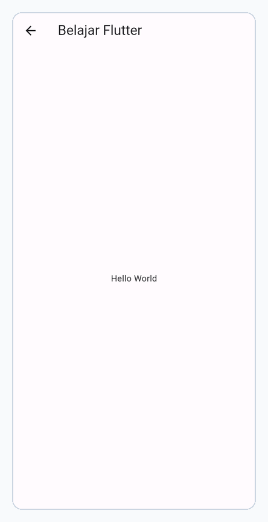

# Laporan Praktikum Pemrograman Mobile
**Nama** : M Fathan Ramdani  
**NIM** : H1D024026  
**Shift** : Awal G / Akhir C  
**Praktikum** : Pemrograman Mobile  

---

## 📝 Tugas Pertemuan 1
**Tanggal**: Selasa, 20 Oktober 2026  
**Topik**: Pengenalan Dasar Bahasa Pemrograman Dart & Pembuatan Aplikasi Pertama Flutter (Hello World)



### Laporan & Kesimpulan Praktikum:
Pada praktikum pertemuan pertama ini, saya mempelajari konsep dasar bahasa pemrograman Dart serta pengenalan awal terhadap framework Flutter. Dart menjadi fondasi utama dalam pengembangan aplikasi di Flutter karena menawarkan performa tinggi, fitur keamanan tipe data (*type safety*), dukungan *null safety*, serta sintaksis bergaya C/Java yang mudah dipahami oleh mahasiswa.

Beberapa materi yang berhasil saya pelajari, eksplorasi, dan implementasikan pada pertemuan ini antara lain:

1. **Pemahaman Dasar Bahasa Pemrograman Dart (Modul 1):**
   - **Tipe Data Fundamental**: Mempelajari dan menguji penggunaan tipe data bilangan bulat (`int`), bilangan pecahan (`double`), teks atau karakter (`String`), serta nilai kebenaran boolean (`bool`). Selain itu, saya juga mencoba penggunaan kata kunci `var` untuk penentuan tipe data secara otomatis (*type inference*).
   - **Operasi Aritmatika & Logika**: Mengimplementasikan perhitungan penjumlahan (`+`), pengurangan (`-`), perkalian (`*`), pembagian (`/`), dan sisa bagi (`%`), serta operasi perbandingan dan logika (`>`, `<`, `==`, `&&`).
   - **Struktur Kontrol**: Menerapkan percabangan bersyarat menggunakan `if-else` untuk penentuan alur program, serta perulangan berulang menggunakan `for loop` dan `while loop`.
   - **Fungsi (Functions)**: Membuat fungsi modular yang menerima parameter dan mengembalikan nilai (*return value*), seperti fungsi perhitungan aritmatika dan fungsi pencetak pesan.
   - **Pemrograman Berorientasi Objek (OOP)**: Merancang sebuah kelas (`Mahasiswa`) lengkap dengan atribut nama, NIM, usia, shift, *constructor*, serta *method* interaktif seperti `perkenalan()` dan `ikutiPraktikum()`.
   - **Pustaka Bawaan (Import)**: Mengimpor dan memanfaatkan library `dart:math` untuk membangkitkan bilangan acak (`Random().nextInt()`), serta menghitung nilai kuadrat dan akar kuadrat.
   - **Penanganan Kesalahan (Exception Handling)**: Mengamankan alur program dari *runtime error* dengan menggunakan blok `try ... on UnsupportedError` dan `try ... catch(e) ... finally`.
   - **Pemrograman Asinkronus (Async-Await)**: Memahami konsep eksekusi *non-blocking* menggunakan `Future`, `async`, dan `await` (mensimulasikan proses unduh data berdurasi waktu tertentu dengan `Future.delayed`).

2. **Pengenalan Framework Flutter & Pembuatan Aplikasi Hello World:**
   - Memahami struktur direktori proyek Flutter standar (folder `lib/` sebagai lokasi utama kode sumber Dart, file `pubspec.yaml` untuk manajemen dependensi dan aset, serta folder platform pendukung seperti `android/`, `ios/`, dan `web/`).
   - Memahami fungsi `main()` sebagai titik masuk (*entry point*) dan pemanggilan `runApp()` untuk menginisialisasi aplikasi.
   - Menerapkan konsep *declarative UI* dengan hierarki *widget tree*:
     - `StatelessWidget`: Digunakan sebagai kelas pembungkus komponen yang bersifat statis dan tidak mengalami perubahan status secara internal.
     - `MaterialApp`: Widget tingkat atas (*root widget*) yang menyediakan tema dan konfigurasi desain Material Design.
     - `Scaffold`: Struktur dasar tata letak layar aplikasi yang menyediakan slot untuk `AppBar` dan `body`.
     - `AppBar`: Menampilkan bilah judul navigasi di bagian atas dengan teks "Belajar Flutter".
     - `Center` dan `Text`: Menempatkan elemen teks "Hello World" tepat di bagian tengah layar perangkat.
   - Mengenal dan memanfaatkan fitur *Hot Reload* dan *Hot Restart*, yang sangat mempercepat proses *development* dan perbaikan tampilan antarmuka secara instan tanpa perlu mematikan aplikasi.

---

## 📁 Struktur Direktori Proyek

```text
├── dart_dasar/                           # Kumpulan latihan dasar Dart (Modul 1)
│   ├── 01_hello_world.dart               # Program cetak teks Hello World Dart
│   ├── 02_tipe_data.dart                 # Demonstrasi tipe data int, double, String, bool, var
│   ├── 03_operasi_matematika_logika.dart # Operasi hitung aritmatika & relasi logika
│   ├── 04_struktur_kontrol.dart          # Percabangan if-else dan perulangan for / while
│   ├── 05_fungsi.dart                    # Definisi fungsi berparameter dan return value
│   ├── 06_kelas_dan_objek.dart           # Konsep OOP (Class Mahasiswa, Constructor, Method)
│   ├── 07_import_library.dart            # Penggunaan library dart:math untuk angka acak
│   ├── 08_eksepsi.dart                   # Penanganan error (try, on Exception, catch, finally)
│   └── 09_async_await.dart               # Pemrograman asinkronus dengan Future dan await
├── docs/
│   └── tugas-1.png                       # Tangkapan layar hasil eksekusi aplikasi Hello World
├── lib/
│   ├── hello_world.dart                  # Widget StatelessWidget halaman Hello World
│   └── main.dart                         # Titik masuk utama aplikasi Flutter (MyApp)
├── pubspec.yaml                          # Berkas konfigurasi dependensi dan versi Flutter
└── README.md                             # Laporan dokumentasi praktikum
```

---

## 🚀 Panduan Menjalankan Program

### 1. Menjalankan Kode Latihan Dart (Modul 1)
Setiap berkas latihan Dart pada folder `dart_dasar/` dapat dijalankan langsung melalui terminal menggunakan perintah Dart SDK:
```bash
# Menjalankan program Hello World Dart
dart run dart_dasar/01_hello_world.dart

# Menjalankan latihan OOP Class Mahasiswa
dart run dart_dasar/06_kelas_dan_objek.dart
```

### 2. Menjalankan Aplikasi Flutter Hello World
Pastikan SDK Flutter sudah terpasang, lalu buka terminal pada direktori proyek:
1. Unduh seluruh dependensi proyek:
   ```bash
   flutter pub get
   ```
2. Jalankan aplikasi pada peramban Chrome atau emulator:
   ```bash
   flutter run -d chrome
   ```
